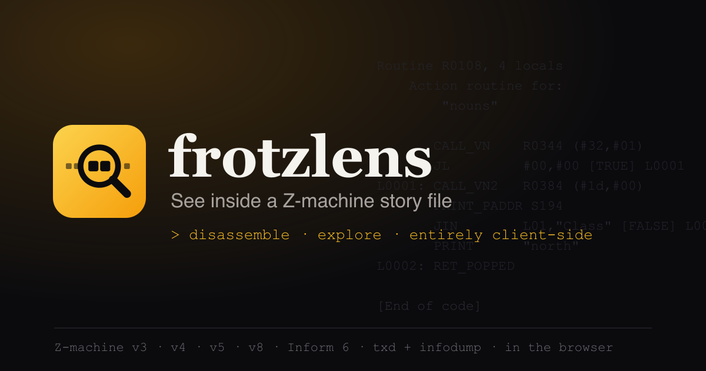
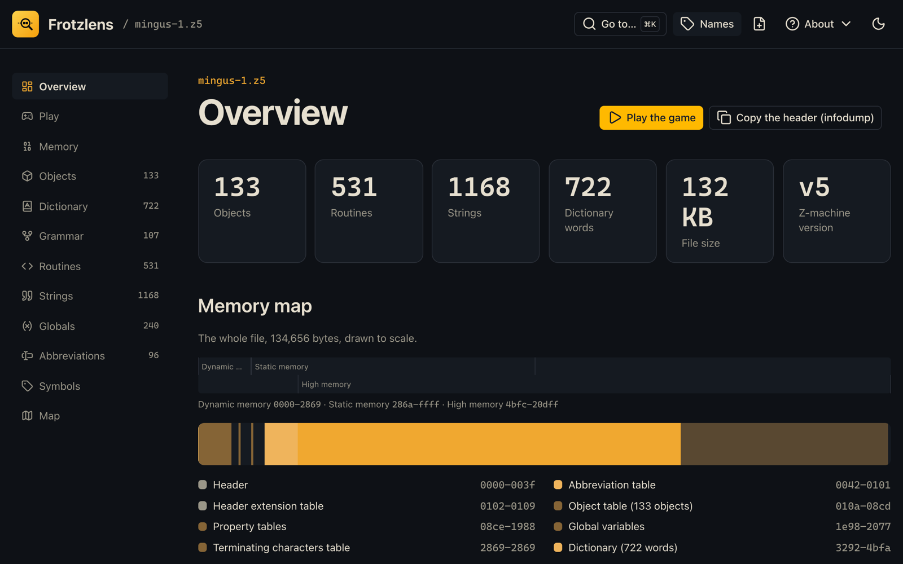
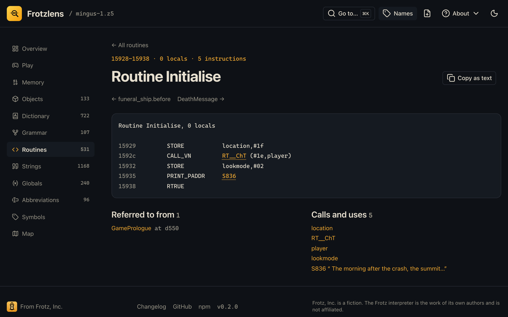
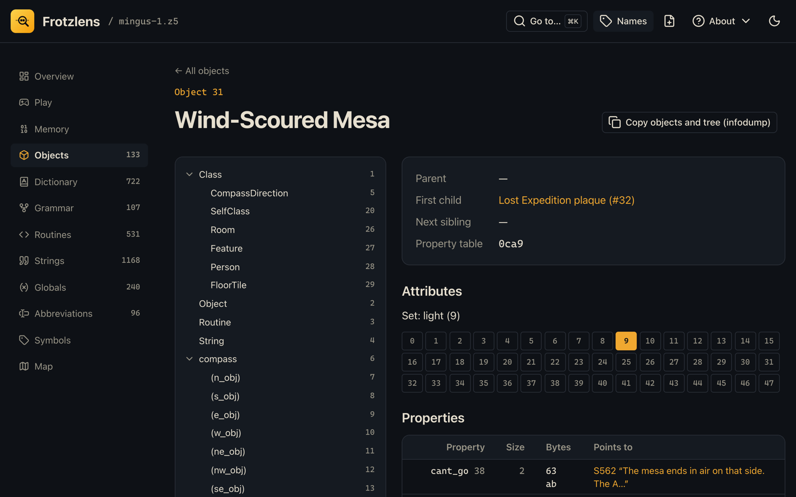
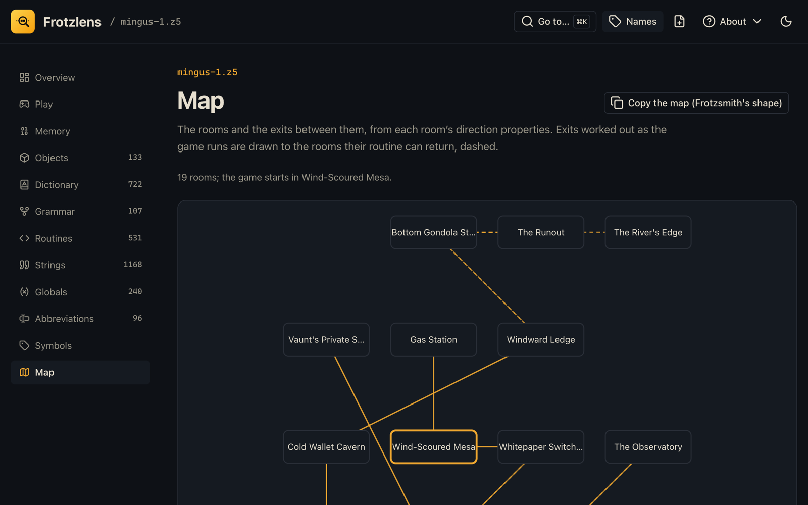
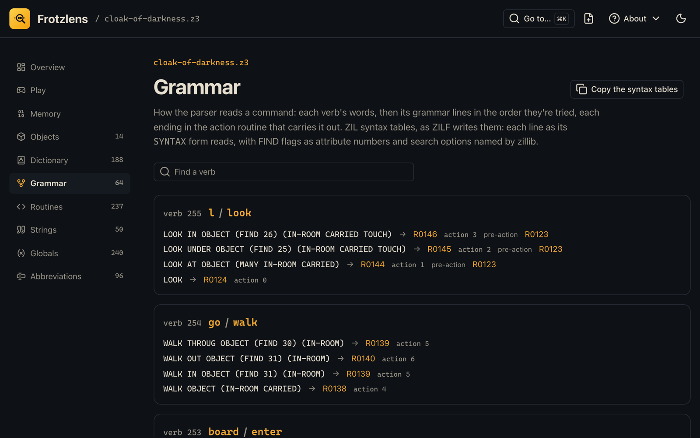
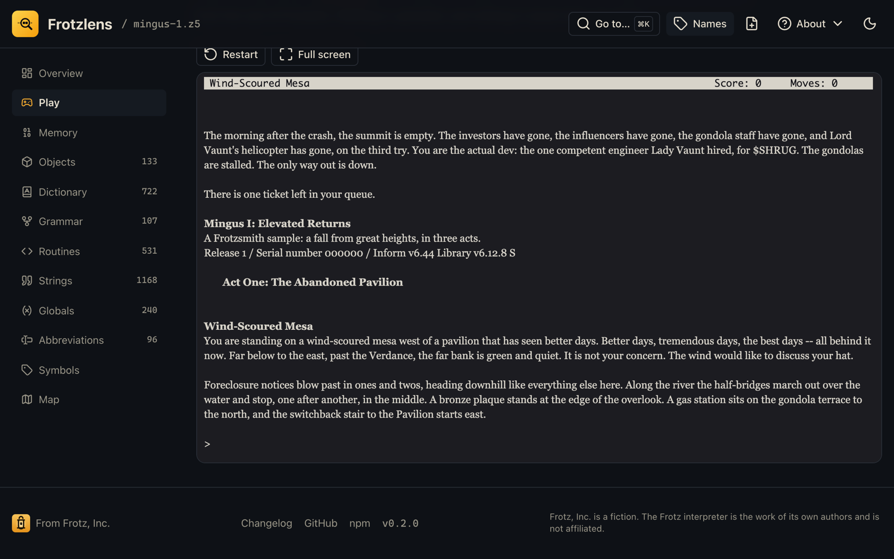
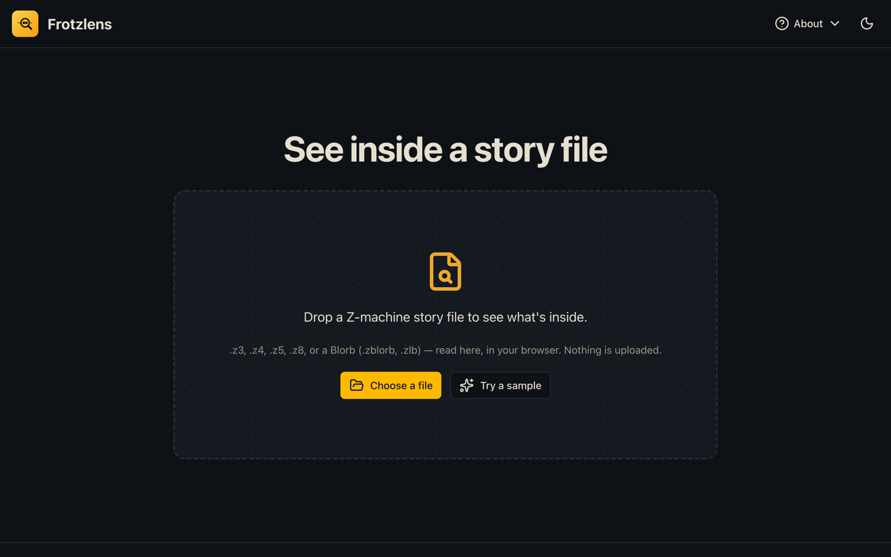
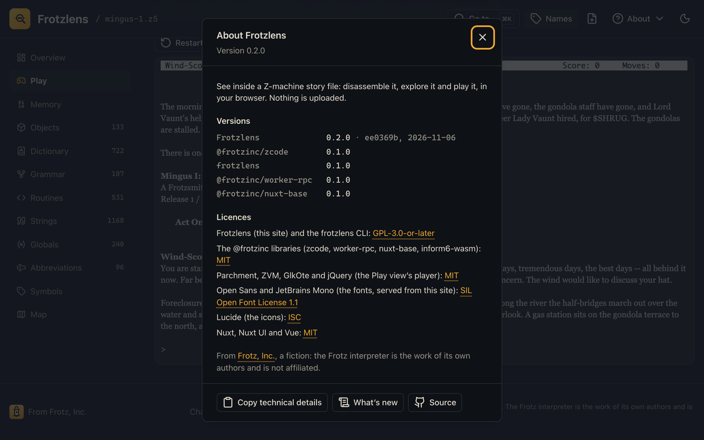

# Frotzlens



[](./LICENSING.md)
[](https://github.com/cschweda/frotzlens/actions/workflows/ci.yml)
[](https://app.netlify.com/projects/frotzlens/deploys)
[](https://www.typescriptlang.org)
[](https://inform-fiction.org/zmachine/standards/)
[](./CHANGELOG.md)

A browser-based disassembler and inspector for Z-machine story files. Drop a `.z3`, `.z4`, `.z5`, `.z8` or `.zblorb` into a tab and see what's inside: the header, the memory map, the object tree, the dictionary and grammar, every routine as cross-referenced disassembly, and every string. Everything runs in your browser; nothing is uploaded.

It's the browser-native successor to Ztools' `txd` and `infodump`, with an Inform 6 focus, and the companion to [Frotzsmith](https://frotzsmith.com), the browser IDE for Inform 6 and ZIL. Both are part of [Frotz, Inc.](https://frotzinc.com), home of the Frotz family of interactive-fiction tools.

Then **play it**, in the same Parchment interpreter Frotzsmith uses, walled off in a sandbox ([details](docs/07-play.md)). What changed, version by version: the [changelog](CHANGELOG.md), also under **About → What's new** on the site.

## Screenshots

| | |
|---|---|
|  **The Overview.** Stats, a memory map drawn to scale, and what made the story (Inform 6.44, the Standard Library 6.12.8). |  **A routine.** txd's disassembly, every routine, string, object and word a link. With the game's `gameinfo.dbg`, names from the source. |
|  **Objects.** The tree, operable from the keyboard, and each object's attributes and properties, decoded. |  **The map.** Rooms and exits read from the story's direction properties, with the debug file; exits a routine decides are dashed. |
|  **ZIL grammar.** A ZILF story's syntax tables, each line as its `SYNTAX` form reads, which Ztools can't read at all. |  **Play.** The story itself, in Parchment, sandboxed from the rest of the site. |
|  **Start here.** Drop a story file, or try the sample. Nothing is uploaded. |  **About.** Every version, the licences, the changelog, and a way to report a problem or suggest a feature. |

## Who it's for

- **Authors** writing in Inform 6 or ZIL (in [Frotzsmith](https://frotzsmith.com) or at the command line) can see what the compiler made of their game.
  - Is that object where it should be?
  - Which grammar lines reach this action?
  - How big are the tables?
  - Where did the code size go?
  - Load the `gameinfo.dbg` and it's their own names throughout. The map comes straight from the story file, so a dead-end exit or a one-way door shows up without playing.
- **Curators and archivists** (the IF Archive, IFDB, anyone keeping old games readable) can find out what a file is without native tools:
  - its compiler and version, and its library and version;
  - its release, serial and checksum;
  - for a Blorb, its cover, resources and iFiction metadata.

  Every routine, object and word has a stable link to cite (`#routine/27f8`).
- **Retro-computing enthusiasts** can look inside the Z-machine, the 1979 virtual machine behind Infocom's games:
  - text packed three letters to two bytes;
  - objects in a tree;
  - a parser driven by tables;
  - all of it laid bare and clickable, and then playable.

  The ZIL grammar decoder is written for Infocom's original syntax-table format too. It has only been tested on ZILF's output, because Infocom's own story files can't be in this repository.
- **Teachers and students** of compilers or virtual machines get a small, complete, real instruction set to study: a stack machine, a disassembly that names everything, and the bytes behind each line.
- **Tool builders and researchers** get [`@frotzinc/zcode`](packages/zcode), a typed model in TypeScript of any version 3, 4, 5 or 8 story file, and a CLI whose output matches `txd` and `infodump`. Old scripts keep working, and `--json` gives the whole model to new ones.
- **Players who are stuck** can play in one tab and, in another, look up the grammar to find the verb the game wants, or the map to see what's beyond the next door.

## What it does that nothing else does

Ztools (`txd`, `infodump`), the reference Z-machine tools since the 1990s, print a story file's insides as text in a terminal. Frotzlens matches their output byte for byte on every Standard Library and library-free story they read correctly. The exceptions are PunyInform's grammar, which Ztools misreads, and one map ([details](docs/03-phase-2-disassembler.md#5-deliberate-differences-from-ztools)). As far as we know, no other tool does any of the following, let alone all of it in a browser tab with nothing installed and nothing uploaded:

- **Everything is linked.** Every routine, string, object, dictionary word and global is a link, with cross-references both ways: what refers to it, and what it refers to. Each grammar line links its action routines, and each verb its words.
- **The source's names.** It reads Inform's `gameinfo.dbg` and shows routines, locals, globals, properties, attributes and actions by name, with a switch back to txd's numbers.
- **What made the story, without symbols.** It identifies the compiler and version, the library and version, and Inform's own veneer routines, by their code.
- **ZIL.** It reads ZILF's syntax tables, where Ztools reads past the end of the file, and checks them against the source (`SYNTAX` forms) in its tests.
- **A map from the story file itself.** Rooms, exits, doors, and the rooms an exit routine can lead to, without playing the game.
- **Play beside the disassembly.** The same story, in Parchment, one click from its code, sandboxed so a hostile file can't reach anything else.
- **Blorb.** It unwraps a Blorb's story and lists the rest.

## Status

| Phase | | |
|---|---|---|
| 0 | Shared libraries extracted from Frotzsmith | **Done.** `@frotzinc/worker-rpc`, `nuxt-base` and `inform6-wasm` 0.1.0 on npm; Frotzsmith uses them. |
| 1 | Core parser and CLI | **Done.** Header, memory map, text, dictionary, objects and globals for v3, v4, v5 and v8, matching `infodump` byte for byte. |
| 2 | Disassembler: routines, strings, grammar, cross-references | **Done.** Every routine and string, Inform grammar (versions 1, 2 and 3), and cross-references. The disassembly matches `txd`, and `-f` matches `infodump -f`, byte for byte on every Standard Library and library-free story. The exceptions are PunyInform's grammar, which Ztools misreads, and `minimal`'s map ([details](docs/03-phase-2-disassembler.md#5-deliberate-differences-from-ztools)). |
| 3 | Web app shell and Overview dashboard | **Done.** Drop a story file (or try the sample) and see the Overview: stats, a to-scale memory map, the story facts. Parsing runs in a Web Worker; every view is a hash route; ⌘K jumps to any routine, object, string or dictionary word. Live at [frotzlens.frotzinc.com](https://frotzlens.frotzinc.com) ([details](docs/04-phase-3-web-shell.md)). |
| 4 | Data views | **Done.** Memory (map and hex), Objects (a keyboard-operable tree), Dictionary, Grammar, Routines (linked disassembly) and Strings, each linked to the rest and each with "Copy as text" in Ztools' format. A Playwright smoke test opens a real story, visits every view and runs axe on each; it runs in CI. Live at [frotzlens.frotzinc.com](https://frotzlens.frotzinc.com) ([details](docs/05-phase-4-data-views.md)). |
| 5 | Debug symbols, Inform fingerprinting, Blorb, polish; Frotzlens 0.1.0 | **Done.** Blorb files open, and a `gameinfo.dbg` names routines, globals, locals, properties, attributes and actions everywhere (with a Names switch). The Overview says what made the story. New views: Globals, Abbreviations, Symbols and Map. `@frotzinc/zcode` and `frotzlens` 0.1.0 are on npm ([details](docs/06-phase-5-symbols.md)). |
| 6 | Decompiling to Inform 6 | **In progress (6d next).** One `.inf` that reads like Inform and recompiles to an equivalent story, checked by compiling it again in the browser. `@frotzinc/zcode` already does it, with or without the story's debug file, the routines as statements (`y = x*2 - g;`, prints, calls) with their control flow as `if`, `while`, `do` and `switch`: every test game (versions 3, 4, 5 and 8) compiles again to an equivalent story; with its debug file, all but one to the same bytes after the header. The app's Source view says how far it has got ([design](docs/09-decompiler.md), [progress](docs/09-decompiler.md#5a-progress-6a-with-and-without-a-debug-file-2026-11-07), [6b](docs/09-decompiler.md#5b-progress-6b-statements-2026-11-07), [6c](docs/09-decompiler.md#5c-progress-6c-control-flow-2026-11-07)). |

**After the phases, 0.2.0 (2026-11-07):** ZIL grammar: a ZILF story's syntax tables, decoded ([details](docs/08-zil-grammar.md)). An About menu with versions, licences, the changelog, problem reports, feature requests and an update check. Everything is in the [changelog](CHANGELOG.md).

The plan and its decisions are in [`docs/`](docs/), starting with [`00-master-design.md`](docs/00-master-design.md).

## Packages

| Package | License | | npm |
|---|---|---|---|
| [`@frotzinc/zcode`](packages/zcode) | MIT | The parser and disassembler: `Uint8Array` in, typed model out, plus `txd`- and `infodump`-format text, Blorb, debug symbols, fingerprinting, the room graph and ZIL grammar | [0.2.0](https://www.npmjs.com/package/@frotzinc/zcode) |
| [`frotzlens`](packages/cli) | GPL-3.0-or-later | The CLI: `frotzlens game.z5`; also `--symbols`, `--info`, `--rooms`, `--json` | [0.2.0](https://www.npmjs.com/package/frotzlens) |
| [`@frotzinc/worker-rpc`](packages/worker-rpc) | MIT | Long-lived Web Worker request/response client | 0.1.0 |
| [`@frotzinc/nuxt-base`](packages/nuxt-base) | MIT | Shared Frotz, Inc. Nuxt layer and Netlify tools | 0.1.0 |
| [`@frotzinc/inform6-wasm`](packages/inform6-wasm) | MIT (wrapper) | Inform 6.44 in WebAssembly, with the Standard Library and PunyInform | 0.1.0 |
| `apps/web` | GPL-3.0-or-later | [frotzlens.frotzinc.com](https://frotzlens.frotzinc.com) | |

Apps are GPL; libraries are MIT. See [`LICENSING.md`](LICENSING.md).

## Try the CLI

```sh
pnpm install && pnpm build
node packages/cli/dist/bin.js samples/dark-cellar.z5                  # the disassembly, as txd prints it
node packages/cli/dist/bin.js --routine 27f8 samples/dark-cellar.z5   # one routine
node packages/cli/dist/bin.js -f samples/dark-cellar.z5               # everything infodump prints
```

[`samples/`](samples/) holds 34 story files to try it on, from a 1.5 KB library-free story to the 135 KB *Mingus I*, as v3, v5 and v8: Frotzsmith's Inform 6 samples plus a minimal Frotzlens fixture, rebuilt with `pnpm samples`.

With no options it prints the disassembly the way `txd` does (`-n` for `txd -n`); with `infodump`'s options (`-i -m -a -o -t -g -d -f -w`) those sections the way `infodump` does, so scripts written for either keep working. `--json` prints the parsed model instead. See [`packages/cli`](packages/cli).

## Development

Node 22 (`.nvmrc`) and pnpm 10 (via corepack: `corepack enable`).

```sh
pnpm install
pnpm build        # build first: packages test against their dependencies' dist/
pnpm typecheck
pnpm test
```

**Test fixtures** are compiled at test time from Inform 6 sources in [`packages/zcode/test/fixtures/src`](packages/zcode/test/fixtures/src) by `@frotzinc/inform6-wasm`, with a fixed serial number so every build is byte-for-byte the same. No story files are checked in.

**Golden files.** `packages/zcode/test/golden` holds `infodump`'s and `txd`'s output for each fixture, and the tests require ours to match it exactly. Ztools has no license, so none of it is in this repository. To regenerate the files, build `infodump` and `txd` yourself outside the repo, then run `cd packages/zcode && scripts/golden.sh /abs/path/to/infodump /abs/path/to/txd` (absolute paths, or paths relative to `packages/zcode`). [`PROVENANCE.md`](packages/zcode/test/golden/PROVENANCE.md) has the exact build command and the archive's checksum.

With `INFODUMP=/path/to/infodump TXD=/path/to/txd pnpm test`, the tests also compare every hand-observed header case, and every story in `samples/`, against the real tools.

CI (`.github/workflows/ci.yml`) runs install, build, typecheck and test on every push to `main`, every pull request and every release tag.

## Releasing a package

Each `@frotzinc/*` package, and the `frotzlens` CLI, is released on its own, from your machine, with [`publish.sh`](publish.sh):

1. Bump `packages/<name>/package.json`'s version and add its `## [x.y.z]` section to `packages/<name>/CHANGELOG.md`.
2. Merge to `main`, then tag and push the tag: `git tag @frotzinc/<name>@x.y.z && git push origin @frotzinc/<name>@x.y.z` (the CLI's tag is `frotzlens@x.y.z`). The `ci` workflow runs on it.
3. `./publish.sh <name> --dry-run`, then `./publish.sh <name>` in a terminal. `<name>` is `zcode`, `cli`, and so on. Publish `zcode` before the `cli` that depends on it. It builds and tests the tag in a temporary worktree, checks the packed files, installs the tarball and runs `scripts/smoke/<name>.mjs` against it, asks you to type the version, and then npm asks for your approval.

The script never commits, tags or pushes.

From [Frotz, Inc.](https://frotzinc.com) — Frotz, Inc. is a fiction. The Frotz interpreter is the work of its own authors and is not affiliated.
