# frotzplay

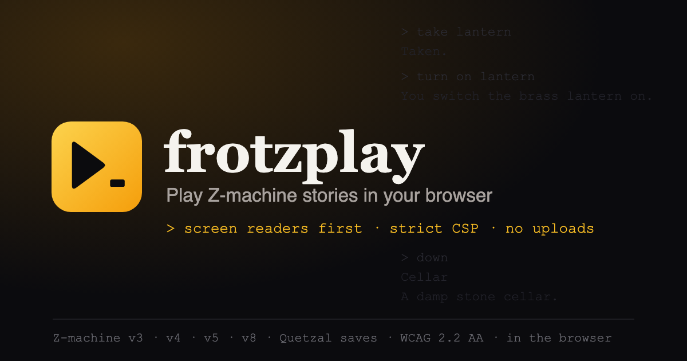

[](../../LICENSING.md)
[](https://inform-fiction.org/zmachine/standards/)
[-0b7285.svg)](../../docs/frotzplay-design.md#6-the-accessibility-contract)
[](./CHANGELOG.md)

A Z-machine player for the web, built for two things: **people who use screen readers**, and **pages with a strict Content-Security-Policy**. It plays version 3, 4, 5 and 8 story files, bare or in a Blorb, in the browser, with nothing uploaded. It's live at **[frotzplay.frotzinc.com](https://frotzplay.frotzinc.com)**. Part of [frotz, inc.](https://frotzinc.com), beside [frotzsmith](https://frotzsmith.com) and [frotzlens](https://frotzlens.frotzinc.com).

> **Status: in development.** The interpreter ([Phases 1](../../docs/11-frotzplay-phase-1-interpreter.md)–[2](../../docs/12-frotzplay-phase-2-state.md)), the player ([Phase 3](../../docs/13-frotzplay-phase-3-player.md)) and this site ([Phase 4](../../docs/14-frotzplay-phase-4-site.md)) are built and tested; it goes live when its Netlify site is connected. Built in this monorepo: the interpreter in [`packages/zmachine`](../../packages/zmachine), the player in `packages/player`, this app in `apps/play`.

## Standing on

frotzplay is a sibling of [Parchment](https://github.com/curiousdannii/parchment), not a rival. For Glulx, TADS, Hugo, ADRIFT and everything that isn't Z-code, use Parchment.

- **[Parchment](https://github.com/curiousdannii/parchment)**, maintained by Dannii Willis since 2008: the web player for interactive fiction, and the prior art for everything here.
- **[ZVM / ifvms.js](https://github.com/curiousdannii/ifvms.js)**, Parchment's former Z-machine engine: frotzplay's test oracle (test-only; shipped in nothing).
- **[Bocfel](https://github.com/garglk/garglk)** (Chris Spiegel), Parchment's Z-machine engine today.
- **[GlkOte](https://github.com/erkyrath/glkote)**, by Andrew Plotkin.
- **[The Z-Machine Standards Document 1.1](https://inform-fiction.org/zmachine/standards/)**, by Graham Nelson, Andrew Hunter and contributors, which the interpreter is written from.
- **[Quetzal](https://inform-fiction.org/zmachine/standards/quetzal/)**, the save-file format, by Martin Frost.
- **[Blorb](https://eblong.com/zarf/blorb/)**, the story-packaging format, by Andrew Plotkin.
- **[Czech](https://ifarchive.org/indexes/if-archive/infocom/interpreters/tools/)** (Amir Karger) and **[Praxix](https://ifarchive.org/indexes/if-archive/infocom/interpreters/tools/)** (Zarf and Dannii), the conformance suites it passes.

## frotzplay and Parchment

| | Parchment | frotzplay |
|---|---|---|
| **Story formats** | Z-code, Glulx, Hugo, TADS 2/3, ADRIFT 4 | Z-code only (versions 3, 4, 5, 8), by design |
| **Z-code engine** | Bocfel, in C, compiled to WebAssembly | `@frotzinc/zmachine`, in TypeScript, one instruction at a time |
| **What an embedding page's CSP must allow** | `'wasm-unsafe-eval'` | Nothing beyond `script-src 'self'; style-src 'self'`: no `eval`, no WebAssembly *(Phase 5)* |
| **Screen readers** | No published accessibility statement | A published accessibility contract, tested by Playwright + axe and by NVDA: one announcement per turn, status line announced on change, verbosity settings, pausable timed input *(Phase 3)* |
| **Single-file, offline page** | Yes: the Site Generator, for every format | Yes: one-click Export of the story you're playing, carrying the contract *(Phase 5)* |
| **`?story=<url>` links** | Yes | Yes, the same parameter, so a link works with either *(Phase 4)* |
| **Saves** | Built in (see Parchment's docs) | Quetzal files you keep, byte-for-byte compatible with ZVM's and restorable in other interpreters *(done)*; autosave *(Phases 3–4)* |
| **Reproducible play** | Not documented | Every session has a seed; the same seed and commands play the same game *(done)* |
| **Maturity** | Since 2008; what IFDB, the IF Archive and most jams use | New, and in development |
| **Licence** | MIT (bundled interpreters under their own licences) | Libraries MIT, this app GPL-3.0-or-later |

*Checked against Parchment 2026.8.23, November 2026. Corrections are welcome: [open an issue](https://github.com/cschweda/frotzlens/issues).*

## Where it stands

| | |
|---|---|
| **Interpreter** | Every opcode of versions 3, 4, 5 and 8. Every sample story, played through with its walkthrough, gives the same transcript as ZVM, turn by turn. Passes **Czech** (0 failures in all four versions) and **Praxix** ("All tests passed"). |
| **Saves** | Quetzal 1.4. A save made here and one made in ZVM are the same bytes, and each restores in both. |
| **Player** | [`@frotzinc/player`](../../packages/player) ([Phase 3](../../docs/13-frotzplay-phase-3-player.md)): the [accessibility contract](../../docs/accessibility.md) built in, 87 Playwright tests in three browsers with axe in every state. |
| **Site** | This app ([Phase 4](../../docs/14-frotzplay-phase-4-site.md)): the start page with the samples, every way a story arrives (a file, a sample, `?story=`, a handover from frotzlens), Blorb covers and titles, one theme for page and player, offline as a PWA. 38 Playwright tests in three browsers, with the production CSP. |
| **Embed, export** | [Phase 5](../../docs/15-frotzplay-phase-5-embed-export.md): `<frotz-play>`, one script that embeds under `script-src 'self'; style-src 'self'` (tested in three browsers); *Export* the story you're playing as one HTML file or a folder, both playing from a double-click. Publishing to npm comes next. |

## Screenshots

| | |
|---|---|
| 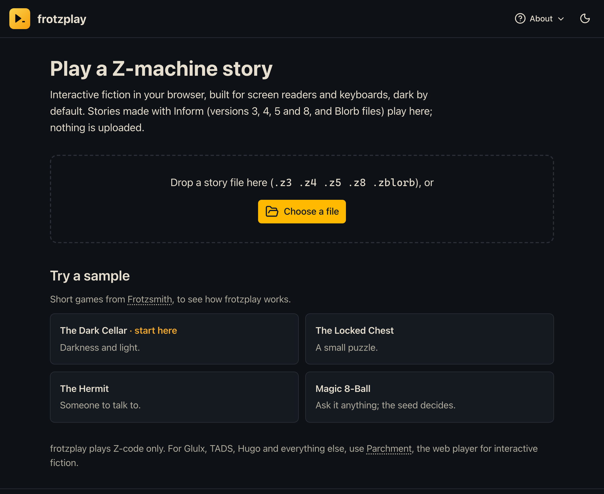 **The start page.** Drop a story, choose a file, or try a sample. | 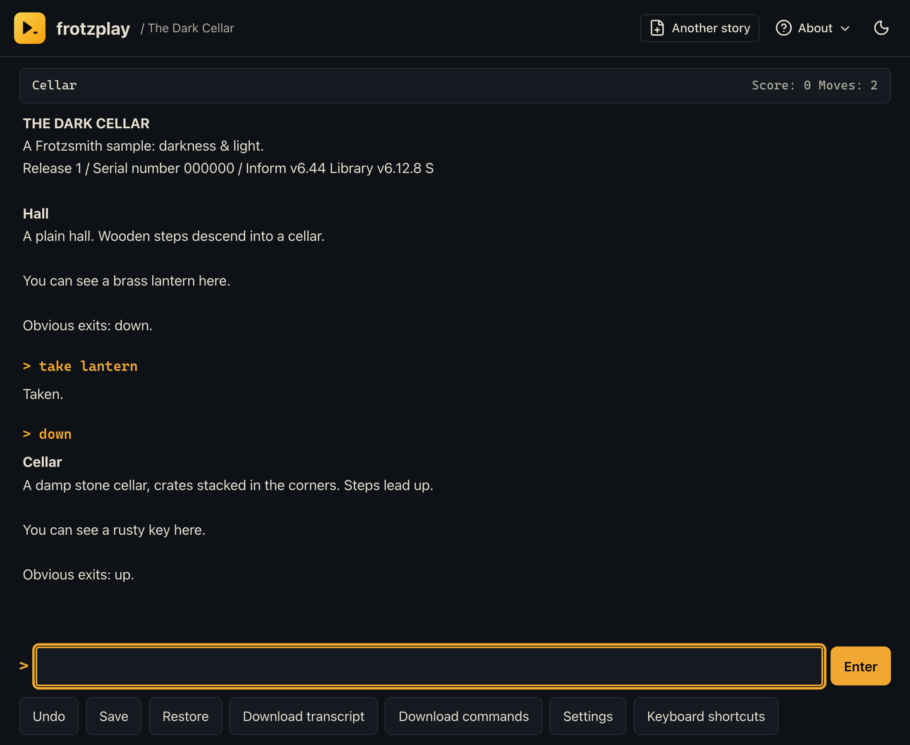 **Playing**, in the family's header and footer. |
| 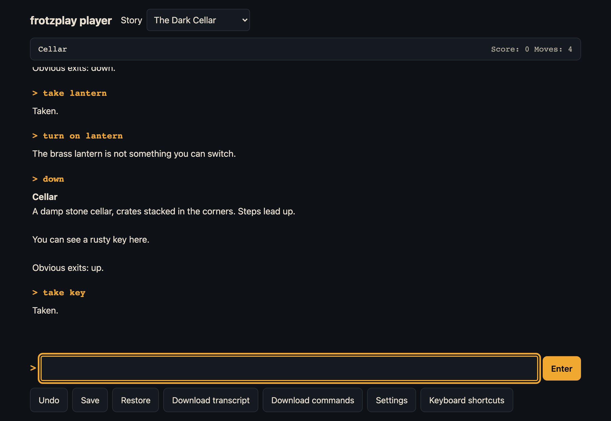 **Dark by default.** Every piece of text at 7:1 contrast or better. One announcement per turn for screen readers; the status line announced only when it changes. | 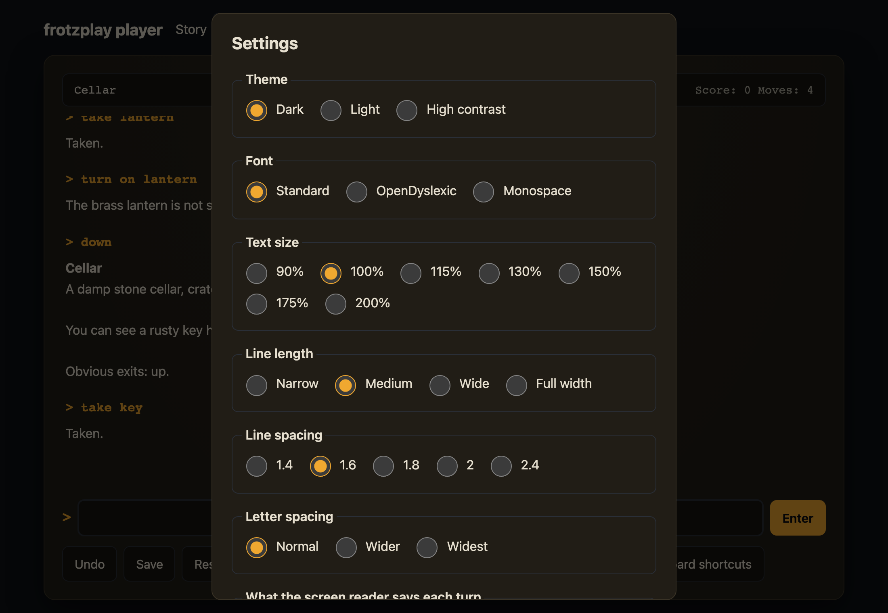 **Settings.** Three themes, OpenDyslexic and monospace, text size and spacing, verbosity, reduced motion, and the story's timers off. |
| 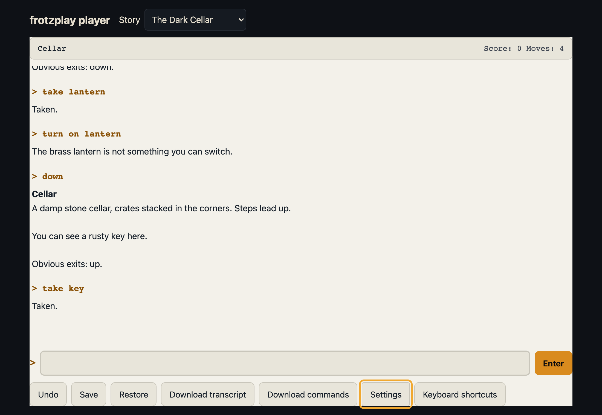 **Light.** | 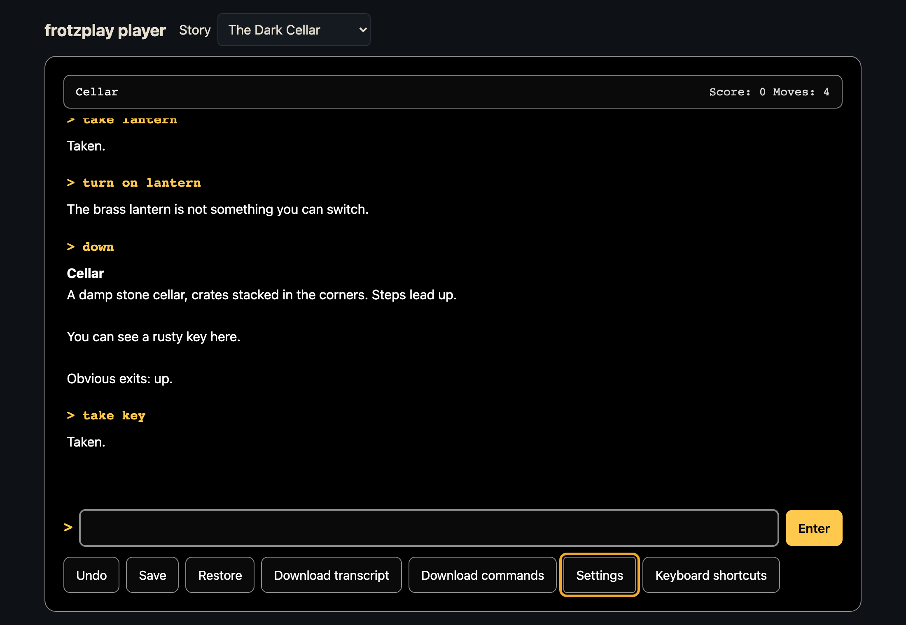 **High contrast.** |
| 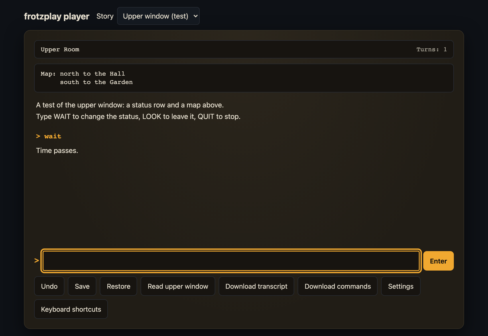 **The upper window as text**, with *Read upper window*. | 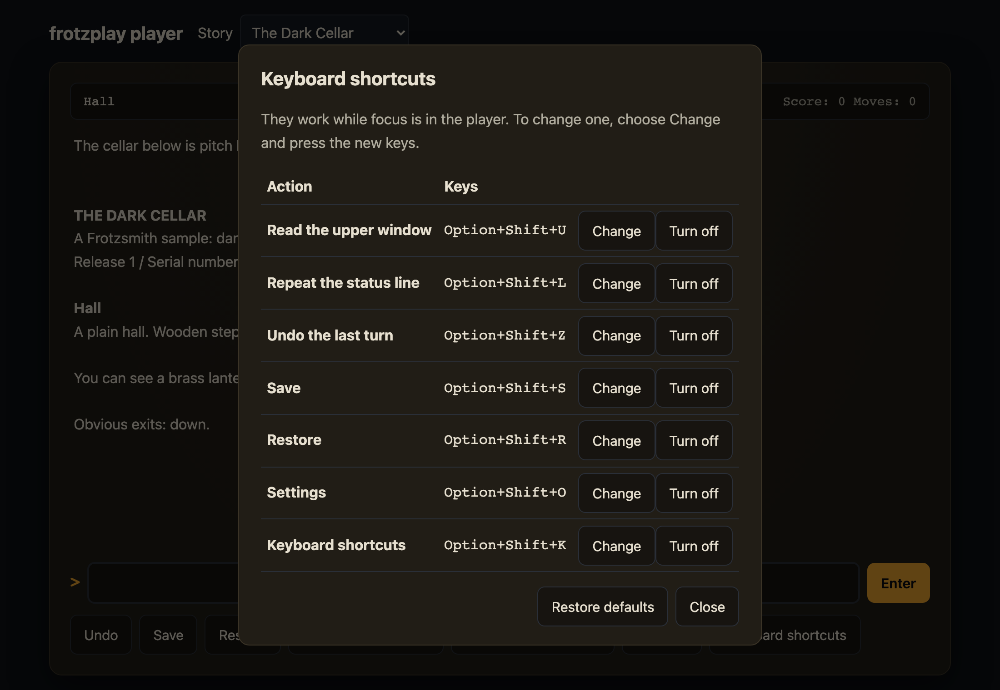 **Keyboard shortcuts**, each changeable or off. |

| 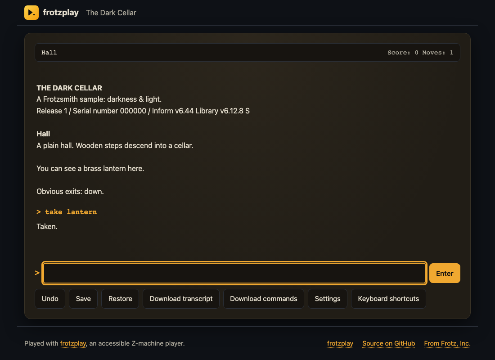 **Export**: one HTML file that plays from a double-click, with frotzplay's branding. | 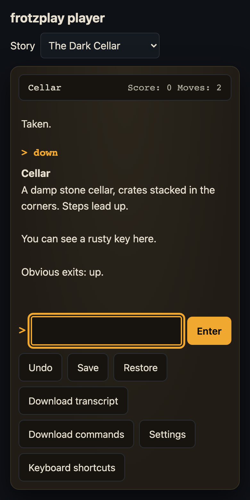 **On a phone.** |

The interpreter also plays from a terminal (`zmachine-run`):

```text
$ zmachine-run samples/dark-cellar.z5 samples/walkthroughs/dark-cellar.txt
The cellar below is pitch black. You'll want a light.

THE DARK CELLAR
A frotzsmith sample: darkness & light.
Release 1 / Serial number 000000 / Inform v6.44 Library v6.12.8 S

Hall
A plain hall. Wooden steps descend into a cellar.

You can see a brass lantern here.

Obvious exits: down.

> down
Darkness
It is pitch dark, and you can't see a thing.

> up
…
> take lantern
Taken.

> down
Cellar
A damp stone cellar, crates stacked in the corners. Steps lead up.

You can see a rusty key here.
```

## What it will do

- **A published, tested accessibility contract** (WCAG 2.2 AA): one announcement per turn, a status line announced only when it changes, verbosity settings, timed input you can pause, everything from the keyboard. Checked by Playwright + axe, and by NVDA before each release.
- **Dark by default, with high-contrast text** (every piece of text at 7:1 or better), and a light theme a click away.
- **Sample stories on the start page**, so you can play at once: The Dark Cellar, The Locked Chest, The Hermit and Magic 8-Ball.
- **Embeds under a strict CSP**: `<frotz-play>` is one script tag.
- **One-click export** to a single self-contained HTML file that plays from a double-click, or a folder ready for any static host.
- **Seeded play** (`?seed=`), Quetzal saves as real files, autosave, undo and transcripts.
- **Parchment's URLs:** `?story=<url>` works the same way.

## Docs

- [`docs/frotzplay-design.md`](../../docs/frotzplay-design.md): the design. What it is, why, the accessibility contract, architecture, testing, phases, open questions.
- [`docs/frotzplay-kickoff-prompt.md`](../../docs/frotzplay-kickoff-prompt.md): the same design in imperative form.
- Phases: [0, the shared shell](../../docs/10-frotzplay-phase-0-shell.md) · [1, the interpreter](../../docs/11-frotzplay-phase-1-interpreter.md) · [2, saves and conformance](../../docs/12-frotzplay-phase-2-state.md).

## Hosting

**To put it live (once, in your personal Netlify account):** Add new project → Import an existing project → GitHub → `cschweda/frotzlens`; branch `main`, **base directory `apps/play`** (build command and publish directory come from `netlify.toml`); project name `frotzplay`; then Domain management → add `frotzplay.frotzinc.com` and its DNS record (a CNAME to `frotzplay.netlify.app`, as for frotzlens). HTTPS follows.

A static Nuxt site on Netlify at frotzplay.frotzinc.com: a second Netlify site on this repo with base directory `apps/play`. [`netlify.toml`](netlify.toml) carries its build, its security headers, and an `ignore` rule that skips the deploy when a commit touches nothing frotzplay is built from. The page's SEO (title, description, Open Graph and Twitter cards, canonical URL, schema.org JSON-LD with accessibility properties) is in [`seo.ts`](seo.ts), from [`site.config.ts`](site.config.ts); `scripts/seo-files.mjs` writes `robots.txt` and `sitemap.xml`. Page views are counted with [Plausible](https://plausible.io) (no cookies; nothing about the story you play), the one outside script the CSP allows. The social card is [`public/og-image.svg`](public/og-image.svg), rendered to `og-image.png` (1200 × 630).

## Licensing

frotz, inc. policy: apps GPL-3.0-or-later, libraries MIT. This app is GPL-3.0-or-later ([`LICENSE`](../../LICENSE)). The libraries, `@frotzinc/zmachine` and `@frotzinc/player`, are MIT and carry their own `LICENSE`, so any site can embed the player. No code from GPL interpreters goes into them.
