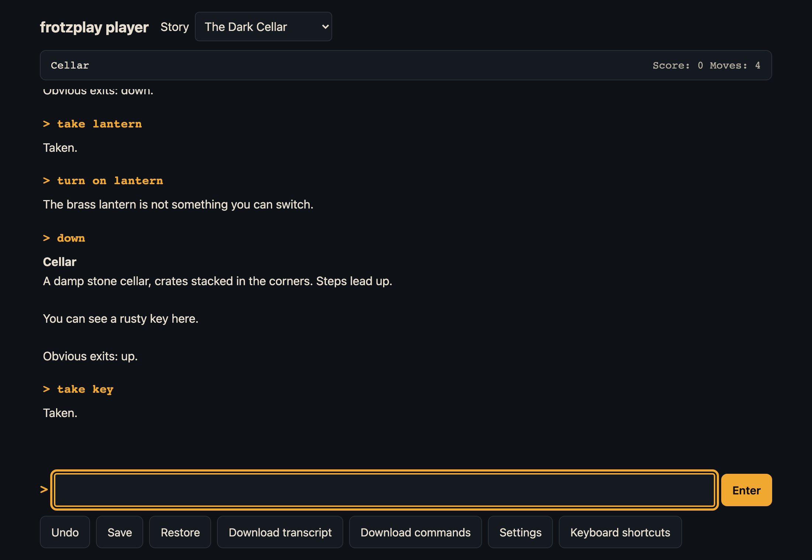

# @frotzinc/player

An accessible Z-machine player as Vue components, on [`@frotzinc/zmachine`](../zmachine). Built for people who use screen readers, and for pages with a strict Content-Security-Policy: plain Vue and its own CSS (no Tailwind, no component library), no inline styles, no `eval`, no WebAssembly. The player behind [frotzplay](../../apps/play).

> **Status: in development** (frotzplay Phase 3). Not yet on npm.



```vue
<script setup lang="ts">
import { ZPlayer } from '@frotzinc/player'
import '@frotzinc/player/player.css'
const story: Uint8Array = /* the story file's bytes */
</script>

<template>
  <main class="h-screen">
    <!-- Give the player a definite height: its story scrolls inside it. -->
    <ZPlayer :story="story" title="The Dark Cellar" />
  </main>
</template>
```

**Props:** `story` (bytes), `title`, `seed` (random when not given), `fontBase` (where the `fonts/` folder is served, default `/fonts/`), `autosave` (default on), `storage`. **Events:** `turn`, `input-wanted`, `quit`, `save`, `error`. **Exposed:** `focusCommand()` (for the host's skip link), `state`, `seed`.

**The host's part:** one `<main>` around it, a skip link that calls `focusCommand()`, a definite height, the page title from the story's title, and the `fonts/` folder served at `fontBase`.

## The accessibility contract

Everything in [`docs/accessibility.md`](../../docs/accessibility.md) is built in: one announcement per turn, the status line announced only when it changes, verbosity settings, the upper window as text, pausable timed input, a command line that keeps focus, changeable shortcuts, dark by default with all text at 7:1, light and high-contrast themes, 200% text, 320-pixel reflow, reduced motion, OpenDyslexic. Each statement has a Playwright test (`e2e/`, in Chromium, Firefox and WebKit) or a unit test (`test/`), and axe runs in every state.

## Development

`pnpm dev` serves the dev page (http://localhost:4180) with the samples and the test stories; `pnpm test` runs the unit tests; `pnpm test:e2e` the contract suite.

## Fonts

`fonts/` holds OpenDyslexic (© Abbie Gonzalez, SIL Open Font License 1.1, unmodified; see `fonts/README.md`). It loads only when chosen.

MIT. From [Frotz, Inc.](https://frotzinc.com).
